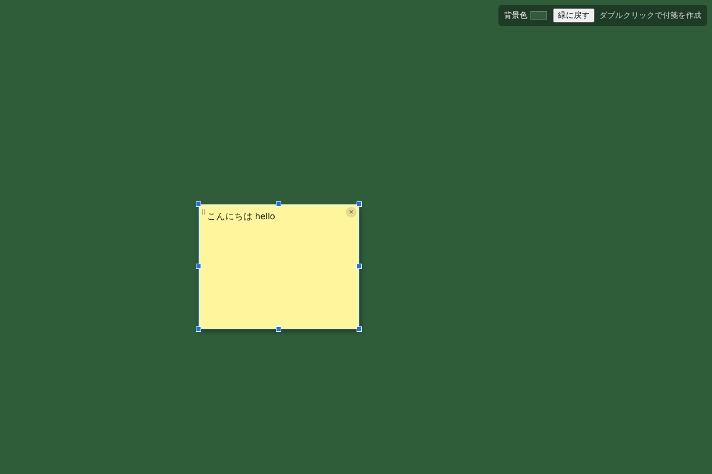

# FusenKokuban（付箋黒板）

黒板のようなウィンドウに付箋を貼れる、クロスプラットフォーム（Windows / macOS / Linux）のデスクトップアプリです。Electron 製。



## 機能

- 背景色を自由に変更（右上の「背景色」。初期値は見やすい緑、「緑に戻す」で初期値へ）
- 背景をダブルクリックすると付箋を作成
- 付箋をクリックすると選択され、周囲8か所のハンドル（四隅＋各辺の中央）をドラッグして拡大・縮小
- 付箋にキーボードで文字入力（日本語入力対応）
- 選択中の付箋は左上のグリップ（⠿）または枠線をドラッグして移動
- 選択中に右上に出る「×」で付箋を削除
- 背景をクリックすると選択解除
- 付箋と背景色は自動保存され、次回起動時に復元

## ダウンロード

GitHub の Actions → `Build` ワークフローの実行結果ページ下部「Artifacts」から各OS版をダウンロードできます。

| OS | ファイル |
| --- | --- |
| Windows | `FusenKokuban-windows-latest`（インストーラ `.exe`） |
| macOS | `FusenKokuban-macos-latest`（`.dmg`、Intel / Apple Silicon 両対応） |
| Linux | `FusenKokuban-ubuntu-latest`（`.AppImage`） |

コード署名をしていないため、初回起動時に警告が出ます。

- **Windows**: 「WindowsによってPCが保護されました」→「詳細情報」→「実行」
- **macOS**: アプリを「アプリケーション」へコピー後、ターミナルで `xattr -cr /Applications/FusenKokuban.app` を実行してから起動
- **Linux**: `chmod +x FusenKokuban-*.AppImage` してから実行

## 開発用の起動方法

```sh
npm install
npm start
```

## パッケージ作成

```sh
npm run dist
```

`dist/` に各OS向けのインストーラ（Windows: NSIS / macOS: dmg / Linux: AppImage）が出力されます。各OSのパッケージはそのOS上でビルドしてください（GitHub Actions の `Build` ワークフローで3OS分をまとめて作成できます）。

## テスト

```sh
npm test   # Linux のヘッドレス環境では xvfb-run -a npm test
```
